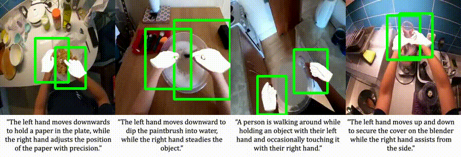
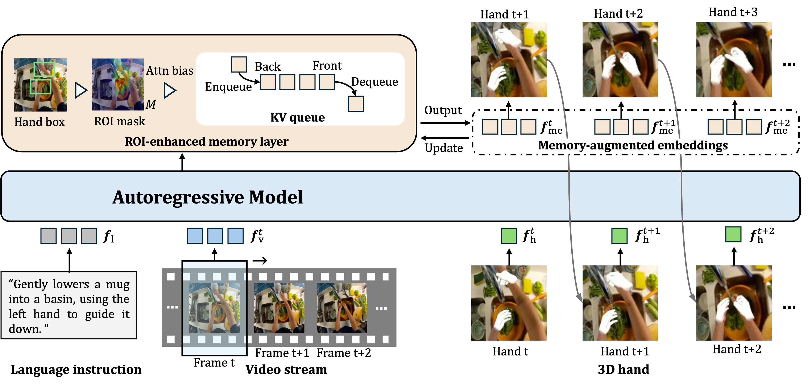

# **Predictive Representation Learning for Manipulation via Streaming Egocentric 3D Hand Forecasting**

<p align="center"><b>SFHand</b> · CoRL 2026</p>

[](https://arxiv.org/pdf/2511.18127)
[](https://huggingface.co/datasets/ut-vision/EgoHaFL)
[](https://huggingface.co/ut-vision/SFHand)

---

## 🔥 **Project Highlights**



| Feature                           | Description                                                                 |
| --------------------------------- | --------------------------------------------------------------------------- |
| 🎯 **Predictive Pretraining**     | 3D hand forecasting as the representation learning objective for manipulation |
| 📡 **Streaming Framework**        | Autoregressive forecasting from a continuous video stream, one frame per step |
| ✋ **Full-State Predictions**      | Hand type, 2D box, 3D MANO pose, and 3D trajectory                          |
| 🧠 **ROI-Enhanced Memory**        | Temporal reasoning focused on hand-centric regions                          |
| 🗣️ **Language-guided**           | Conditioned on fine-grained natural language instructions                   |
| 🤖 **Embodied Transfer**          | SOTA on Franka Kitchen, Adroit, and a real Franka Research 3 arm            |

---

## 🎬 **Method Overview**



---

## 📝 **Introduction**

> 💡 **Forecasting 3D human hand motion is a better pretraining task for representation learning in embodied manipulation.**

Existing representation learning methods for manipulation largely stop at perceptual understanding, i.e., what a scene contains or what an action is. A capable embodied agent also needs to predict the next motion. We propose forecasting 3D human hand motion as a pretraining task: the representation jointly learns how humans manipulate objects and how the motion will unfold next.

**SFHand** is the first representation learning method via streaming egocentric 3D hand forecasting. It autoregressively predicts future 3D hand states (hand type, 2D bounding box, 3D pose, and trajectory) from a continuous stream of egocentric video and a language instruction. An **ROI-enhanced memory layer** captures temporal context while focusing on salient hand-centric regions.

**EgoHaFL** (Egocentric 3D Hand Forecasting with Language) is the first open-source large-scale dataset pairing synchronized 3D hand poses with fine-grained language instructions (247K clips, 3.95M annotated frames).

Transferred to downstream embodied control with frozen encoders, SFHand representations reach state-of-the-art success rates on Franka Kitchen, Adroit, and real-world Franka Research 3 manipulation (up to +13.4% success rate), while also achieving leading 3D hand forecasting accuracy (35.8% lower ADE than baselines).

---

## 📦 **Project Status**

| Component                                        | Status         |
| ------------------------------------------------ | -------------- |
| EgoHaFL Dataset                                  | ✅              |
| Pretraining Code                                 | ✅              |
| Pretrained Weights                               | ✅              |
| 3D Hand Forecasting Evaluation                   | ✅              |
| Embodied Evaluation (Franka Kitchen / Adroit)    | 🔜 Coming soon |
| 3D Hand Annotation Code                          | 🔜 Coming soon |

---

## 🔧 **Installation**
We develop and test the project under: `torch 2.8.0+cu129`.
```bash
git clone git@github.com:ut-vision/SFHand.git

conda env create -f environment.yml
conda activate sfhand

pip install -r requirements.txt
conda install -c conda-forge libgl
```

Download [MANO model](https://mano.is.tue.mpg.de/) and put `MANO_LEFT.pkl` and `MANO_RIGHT.pkl` under `data/mano`.

Download `base_best.pt` from [EgoHOD checkpoint](https://huggingface.co/Jazzcharles/EgoVideo) and place it at `./pre_ckpt/base_best.pt`.

---

## 📂 **Dataset: EgoHaFL**

EgoHaFL Dataset (annotations)：
👉 [https://huggingface.co/datasets/ut-vision/EgoHaFL](https://huggingface.co/datasets/ut-vision/EgoHaFL)

Videos originate from Ego4D V1: [https://ego4d-data.org/](https://ego4d-data.org/).
We use **224p compressed clips**.

Each video is divided into consecutive 3-second clips. Every clip is paired with a fine-grained, sentence-level instruction (from EgoHOD) and 3D hand annotations (MANO parameters and 3D joints) at 16 frames per clip, converted to metric coordinates with camera intrinsics from EgoVid. The dataset contains 247K clips in total: 242K for training and 5K for testing.

Directory structure:

```
EgoHaFL
    ├── EgoHaFL_lmdb
    │   ├── data.mdb
    │   └── lock.mdb
    ├── EgoHaFL_train.csv
    ├── EgoHaFL_test.csv
    └── v1
        └── videos_224p
```

---

## 🚀 **Pretraining & Evaluation**

### **Pretrain + Eval (3D hand forecasting)**

```bash
bash ./exps/pretrain.sh
```

> ⚠️ Before training, edit configs in `./configs`.

### **Eval + Visualization**

```bash
python main.py --config_file configs/config/clip_base_eval.yml --eval --vis
```

Output visualizations → `./render_results/`

---

## 🧠 **Pretrained Models**

Download here:

👉 [https://huggingface.co/ut-vision/SFHand](https://huggingface.co/ut-vision/SFHand)

---

## 🤖 **Embodied Evaluation (Franka Kitchen / Adroit)**

> ⏳ Coming soon — code for transferring the pretrained SFHand encoders to downstream manipulation policies (frozen encoder + lightweight policy head) will be added once finalized.

---

## ✍️ **3D Hand Annotation**

> ⏳ Coming soon — detailed annotation tools, formats, and processing scripts will be released once finalized.

---

## 📚 **Citation**

```latex
@inproceedings{liu2026sfhand,
  title={Predictive Representation Learning for Manipulation via Streaming Egocentric 3D Hand Forecasting},
  author={Liu, Ruicong and Huang, Yifei and Ouyang, Liangyang and Kang, Caixin and Sato, Yoichi},
  booktitle={Conference on Robot Learning (CoRL)},
  year={2026}
}
```

---

## 🙏 **Acknowledgement**

SFHand builds on **[EgoHOD](https://github.com/InternRobotics/EgoHOD)**.
Thanks to all contributors of the original codebase.
